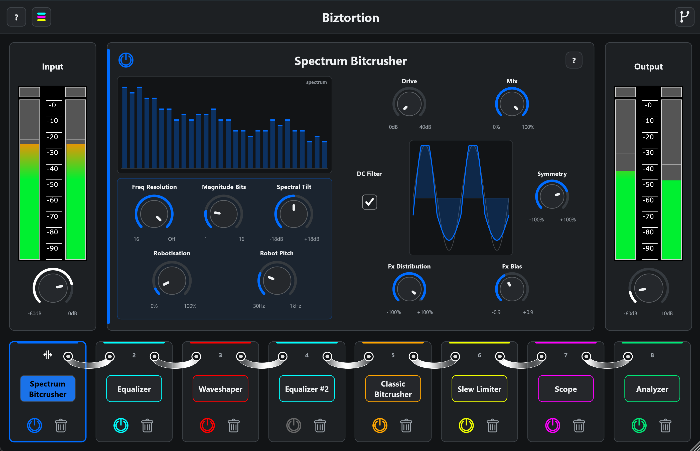

# Biztortion

[](https://www.gnu.org/licenses/gpl-3.0)

[](http://hits.dwyl.com/killbizz/Biztortion)

Modular distortion plugin for VST3-based hosts, written in C++ with the JUCE framework.

Built for creative sound design — aimed mainly at **Electronic Dance Music** production, but equally at home in audio post-production.

Windows/macOS installers are available for `FREE DOWNLOAD` in the [releases section](https://github.com/killbizz/Biztortion/releases/).



> This repository contains the thesis project for the bachelor degree in Electronic Music of Gabriel Bizzo at the C. Pollini Conservatory of Music in Padua (Italy). The thesis document, written in Italian, is an in-depth study of audio distortion and a technical analysis of the algorithms implemented here.
>
> **v2** developed with the help of AI coding assistance.

## How it works

Build a processing chain by dropping modules into the eight slots at the bottom of the window. Signal flows left to right; **drag slots** to reorder them, **double-click** a slot name (or press `F2`) to rename it, and click a slot to open that module in the main view.

Every distortion module shares a common set of controls — **drive**, **mix**, **fx distribution**, **fx bias**, **symmetry** and **dc filter** — laid out around a graph showing the transfer function they apply. Fx bias sets the threshold that splits the waveform and fx distribution decides how much of the effect each side receives, so you can distort only the upper or only the lower half of the signal.

## Modules

### Distortion

| Module | What it does |
| --- | --- |
| **Waveshaper** | Remaps the waveform through combined tanh and sine curves, from soft saturation to complex folding |
| **Classic Bitcrusher** | Reduces sampling rate and bit depth for digital crunch, with signal-dependent dither |
| **Spectrum Bitcrusher** | Crushes the spectrum instead of the samples: frequency resolution, magnitude quantisation, spectral tilt and robotisation |
| **Slew Limiter** | Limits how fast the signal may rise and fall, a staple of analog modular synths |

### Tone & analysis

| Module | What it does |
| --- | --- |
| **Equalizer** | Two peak filters plus low/high cut, with a built-in spectrum analyzer. Drag the points on the curve to set frequency and gain, scroll them for Q or slope, double-click to bypass a band |
| **Spectrum Analyzer** | Standalone 20 Hz – 20 kHz analyzer with freeze, horizontal/vertical zoom and drag-to-explore |
| **Oscilloscope** | Waveform view, synced to a rising zero crossing, with freeze, time/amplitude zoom and drag-to-explore |
| **Input/Output stage** | Level metering and gain at both ends of the chain, for total dynamics control |

Each module carries a `?` button explaining what it does, and the header holds an **About** button and a **legend** of the module colours.

## Dependencies

- [JUCE Framework](https://github.com/juce-framework/JUCE) v8.0.14 (GNU GPLv3)
- [ff_meters](https://github.com/ffAudio/ff_meters) (BSD 3-clause)

Clone them as siblings of this repository, inside a workspace folder that also holds the CMake
project:

```
workspace/
├── CMakeLists.txt   CMake build for the plugin + dependencies
├── Biztortion/      this repository
├── JUCE/
└── ff_meters/
```

## Building

### CMake (recommended)

Requires CMake 3.22+ and a C++20 compiler. From the `workspace` folder:

```bash
cmake -S . -B build -DCMAKE_BUILD_TYPE=Debug
cmake --build build --target Biztortion_All
```

Targets: `Biztortion_VST3`, `Biztortion_Standalone`, `Biztortion_All`, and `AudioPluginHost` (JUCE's plug-in host, handy for debugging the plugin).

Artefacts land in `build/Biztortion_artefacts/<config>/`. Opening `workspace` in VS Code with the **CMake Tools** and **C/C++** extensions gives configure, build and debug out of the box — see `DEVELOPING.md` next to the `CMakeLists.txt`.

### Projucer

1. Build the Projucer from `JUCE/extras/Projucer` (or use a prebuilt one).
2. Open `Biztortion.jucer`. Module paths are already set to the sibling `JUCE/` and `ff_meters/` checkouts, so nothing needs pointing at by hand.
3. Click **Save and Open in IDE**, then build the exported project.

Exporters are provided for Visual Studio 2022 and Xcode. The `.jucer` and the CMake build describe the same sources — if you add files, update both.

## License

Biztortion is licensed under the GNU GPLv3 license.
